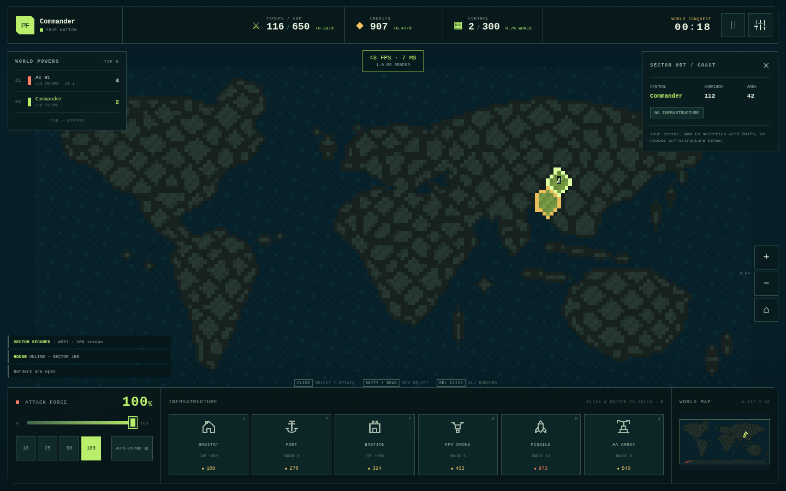

# PIXEL FRONTIER · V0.1

Адаптивная пиксельная стратегия захвата территорий: одиночная игра против утилитарного ИИ и авторитетные multiplayer-комнаты на Node.js. Работает без сборки и без внешних CDN, шрифтов, картинок или аудиофайлов.

**Публичный запуск:** https://pixel-frontier-eoqt.onrender.com  
**Репозиторий:** https://github.com/BlackJack650/pixel-frontier



## Запуск

Требуется **Node.js 20+**.

```bash
npm install
npm start
# открыть http://localhost:3000
```

Сервер слушает `0.0.0.0`; порт переопределяется через `PORT=8080 npm start`. HTTP, статика и WebSocket `/ws` используют один порт. Дополнительная сборка не нужна.

## Архитектурные решения и допущения — 12 строк

1. Клиент — нативные ES-модули, Canvas 2D и чистый CSS; Vite/бандлер для V0.1 не нужен.
2. Соло использует ту же серверную `GameRoom`, что и multiplayer: отдельной клиентской «читерской» симуляции нет.
3. Сервер выполняет фиксированные 20 тиков/с; клиент отправляет только намерения с `cmdId`.
4. Снапшоты отправляются 10 раз/с; регионы передаются дельтой, компактный JSON квантует войска до целых.
5. Мир — растровая сетка 192×96 и 300/350 связных регионов; seed повторяет старт и решения ИИ.
6. Победа в вертикальном срезе — **25% мира** или последняя нация; порог настраивается вплоть до 100%.
7. Все боевые параметры собраны в `config/balance.js` и реэкспортированы через `config.js`.
8. ИИ получает те же войска, цены и ограничения; сложность меняет реакцию, агрессию и приоритеты, а не ресурсы.
9. Звук и простой музыкальный луп синтезируются Web Audio API после первого пользовательского действия.
10. Состояние матчей — в памяти; агрегированная статистика сохраняется в `data/profile.json`.
11. Реконнект по session token сохраняет страну 90 с; явный выход сразу передаёт её боту уровня 3.
12. Масштабирование V0.2 подготовлено интерфейсом `IGameServer`; Redis и master/worker намеренно не поднимаются.

## Как играть

1. **Выделите** свой регион кликом. `Shift` добавляет/снимает регионы, `Shift + drag` выделяет рамкой, двойной клик по своему региону выбирает все пограничные.
2. Установите **силу атаки 0–100%** и кликните по соседней цели. Клиент автоматически использует только выделенные источники, которые могут достичь цели.
3. Выберите постройку в нижнем доке и кликните по своему региону. Повторная установка того же типа — апгрейд до уровня 5.
4. **Порт** ставится только на берег и разрешает атаки через короткие проливы. Дроны и ракеты сами выбирают инфраструктуру противника в радиусе.
5. Захватите **25% секторов** или уничтожьте все конкурирующие нации. В соло поражение показывает результат сразу.

### Управление

| Ввод | Действие |
|---|---|
| Drag / WASD / стрелки | Панорама |
| Колесо / pinch / Q, E | Зум |
| Tap | Выбор своего региона или атака цели |
| Long-press | Все свои пограничные регионы |
| Double-click / double-tap | Все границы / атака цели |
| 1…5 | 20 / 40 / 60 / 80 / 100% силы |
| B | Быстрый выбор дома / отмена строительства |
| Space | Пауза в соло |
| Tab | Полный лидерборд |
| F3 | FPS, ping и время рендера |
| Esc / правый клик | Отмена режима или выделения |

Миникарта кликабельна. Интерактивные цели рассчитаны на касание; раскладка перестраивается на ширине от 360 px.

## Проверка

```bash
npm test                                  # 27 unit/integration/map/protocol tests
npm run sim -- --ai 8 --minutes 5 --seed 42
npm run smoke:network                     # при уже запущенном npm start
```

Проверенный benchmark: 8 смешанных ИИ, seed 42 — закончился на **271 игровой секунде**, лидер контролировал **75/300 регионов**; состояние прошло инварианты владельцев, войск и уровней построек.

Дополнительно выполнен Chromium smoke: создание матча, дом `300 → 650 cap`, отказ атаки 0%, уход 100% гарнизона, захват после волны, два сетевых клиента, чат и реконнект. Во время проверки консоль была чистой, внешних запросов — 0. В headless Chromium рендер занимал **1.0–1.8 мс/кадр**; аппаратный FPS телефона этим не сертифицируется.

## Баланс

Все числа ниже находятся в `config/balance.js`. Время указано в секундах, дистанции — в клетках исходной сетки.

| Параметр | Значение |
|---|---:|
| Тик / снапшоты | 20 Hz / 10 Hz |
| Регионы | 300 standard / 350 large |
| Старт | 120 войск (40% cap), 200 credits |
| Прирост войск / с | `0.30 × regions^0.92 × (1 + 0.03 × houseLevels)` |
| Лимит войск | `300 + 350 × houseLevels` |
| Экономика / с | `0.06 × regions + 0.35 × houseLevels` |
| Торговля / с | `0.5 × portLevels × (1 + 0.05 × regions / 100)` |
| Нейтральная защита | `1 + 0.5 × troops + 0.16 × sqrt(area)` |
| Волна | `0.25 + 0.05 × tiles`; bastion ×1.5 |
| Кулдаун / лимит команд | 100 мс / 30 команд·с⁻¹ |
| Реконнект / TTL пустой комнаты | 90 с / 60 с |
| Порог Domination | 25% |

| Постройка | HP за уровень | Цена L1 | Радиус / период | Эффект |
|---|---:|---:|---|---|
| Habitat (`house`) | 100 | 100 | Вся страна | +350 cap, +3% роста, +0.35 дохода за уровень |
| Port (`port`) | 120 | 250 | 6 | +0.5 торговли, морская атака, +15% силы десанта/ур. |
| Bastion (`fort`) | 150 | 300 | 4 | +10% защиты/ур., −8% силы атаки/ур., волна ×1.5 |
| FPV drone (`drone`) | 80 | 400 | 5 / 20 с | 25 × level урона случайной вражеской постройке |
| Missile (`missile`) | 60 | 900 | 12 / 60 с | 120 × level урона, полёт 2.5 с, splash 1.5 |
| AA array (`aa`) | 100 | 500 | 6 / 8 с | Перехват дрона; ракета — 25%/ур., максимум 90% |

- Новая цена: `baseCost × 1.08^buildingCount`.
- Апгрейд: `baseCost × 1.6^(level−1) × 1.08^buildingCount`.
- Апгрейд восстанавливает `50% нового maxHP`; пассивной регенерации нет.
- При захвате постройка становится целой, повреждённой или разрушенной; повреждение снижает HP на 50% и уровень на 1, минимум до 1.
- Эффект захваченной постройки включается со следующего тика.

## Структура

```text
client/                 Canvas, UI, Web Audio, WS client
config/balance.js       Единственный источник игровых констант
shared/                 Формулы, RNG, протокол, карты JSON
server/rooms/           GameRoom и RoomManager
server/sim/             Бой, инфраструктура, снаряды
server/ai/              Утилитарный контроллер
server/interfaces/      Контракт будущего распределённого host
tools/buildMap.js       Генератор двух карт
tools/simulate.js       Headless benchmark
tools/smokeNetwork.js   Два клиента + чат + реконнект
tests/                  27 автоматических тестов
docs/DESIGN.md          Подробные решения и отличия
```

## Чек-лист приёмки

| № | Статус | Результат |
|---|---|---|
| 1 | **Сделано** | `npm install && npm start` запускает игру без сборки. |
| 2 | **Сделано** | Уровень 1 проверен в Chromium; 8 mixed завершили headless-матч с победителем. |
| 3 | **Сделано** | 0% отклонено; 100% списало весь гарнизон в браузерном тесте. |
| 4 | **Сделано** | Дом, порт/торговля, fort, drone, missile и AA покрыты формульными/интеграционными тестами. |
| 5 | **Сделано** | Уровни 1–5, 6-й возвращает `MAX_LEVEL`; глобальный рост цен включён. |
| 6 | **Сделано** | HP не растёт со временем; тест специально проверяет повреждённую постройку. |
| 7 | **Сделано** | Три исхода детерминированно покрыты тестом; события видны в журнале/feed. |
| 8 | **Сделано** | Два WS-клиента получили идентичные 300 регионов; token reconnect прошёл. |
| 9 | **Сделано** | AudioContext создаётся по действию; mute и три громкости хранятся локально. |
| 10 | **Сделано / проверка** | 360×740: нет overflow, кнопки доступны, док прокручивает постройки. Тач-жесты реализованы; физический телефон не тестировался. |
| 11 | **Отличие** | F3 есть, render budget соблюдён (1.0–1.8 мс). Headless software Chromium показал 35–48 FPS, поэтому ≥55 FPS на реальном телефоне не заявляется как измеренный факт. |
| 12 | **Сделано** | Runtime network log: только same-origin HTTP/WS, внешних доменов 0. |

### Осознанные ограничения V0.1

- Дельта-снапшоты есть, но viewport-based **interest management** пока не фильтрует данные: без тумана войны все владельцы и гарнизоны публичны.
- Рендер использует один компактный `ImageData` 192×96 и dirty-перерисовку; строгий zero-allocation loop и пулы всех объектов оставлены для профилируемой оптимизации V0.2.
- Карта рисуется процедурно по континентальным полигонам, а не по детализированному GIS-контуру Земли.
- Матчмейкинг, аккаунты и распределённые комнаты не входят в этот срез.

## Публичный деплой с WebSocket

В корне добавлены `Dockerfile`, `.dockerignore` и `render.yaml`. Контейнер запускает тот же `npm start`, слушает `PORT` платформы и не требует сборки клиента.

### Render Blueprint

1. Загрузите проект в Git-репозиторий.
2. В Render выберите **New → Blueprint** и укажите репозиторий с `render.yaml`.
3. После запуска используйте выданный `https://…onrender.com` — HTTP и `/ws` работают на одном домене.

Free instance Render может «засыпать» без трафика, а JSON-статистика эфемерна. Для постоянного процесса выберите paid instance; матчи в памяти всё равно рассчитаны на один процесс.

### Docker вручную

```bash
docker build -t pixel-frontier .
docker run --rm -p 3000:3000 pixel-frontier
```

Vercel не используется для полного варианта: его serverless-функции не подходят для постоянного WebSocket-процесса с комнатами в памяти.

## V0.2 — следующие шаги

1. Профили/аккаунты, рейтинг/Elo и расширенная статистика.
2. Дипломатия, союзы, приватные команды и туман войны с серверным interest management.
3. Редактор масок, дополнительные карты/сценарии и загрузка пользовательских seed-пресетов.
4. Реплеи из потока команд, пересинхронизация и verifier детерминизма.
5. Master/worker room routing и опциональный Redis lobby bus поверх `IGameServer`.
6. Пулы снарядов/эффектов, пространственный индекс, физический device lab 360 px / 4K.
7. PWA, кастомизация флага, достижения; магазин — только после отдельного продуктового решения.
